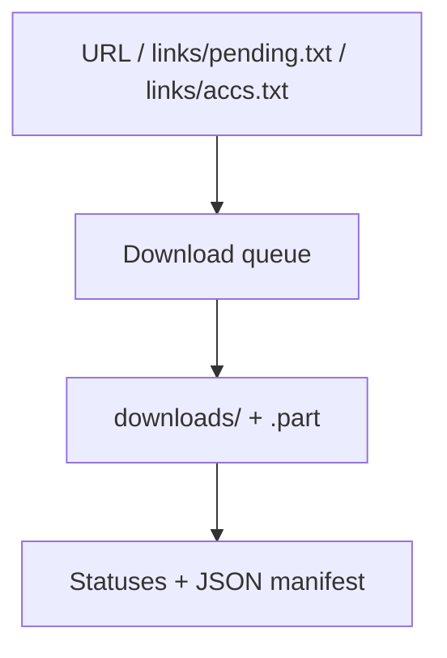
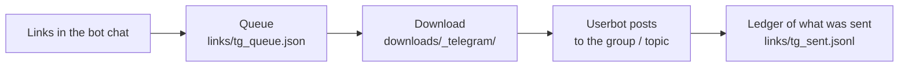

# 📥 EromeDownloader

> Command-line downloader for public Erome albums, media files and accounts.

🌐 **Language / Язык:** [English](README.md) · [Русский](README_RU.md)


## 📌 Overview

The program downloads public Erome albums, individual files and new albums from accounts. It supports queues, parallel downloads, resuming and account tracking. The interface is a console menu: after launch the main menu is shown and you pick a mode by number. One mode is a Telegram bot: you send it links to albums and profiles, and it downloads them and posts them to your group.

> [!NOTE]
> Erome authentication, cookies and private albums are not supported.

## ✨ Features

- Five modes: single link, queue, account check, scan-only for new albums, Telegram bot
- Telegram bot: album and profile links from a chat → download → posting to a group or topic from your own account; send as many links as you like without waiting for the previous ones
- Parallel downloading of multiple albums and files
- Resuming via `.part` files and HTTP Range
- Tracking new account albums (`links/accs.txt`)
- Queue status files and a JSON manifest
- Optional sorting of albums by size and `skip_videos` / `skip_images` filters
- Importing links from browser bookmarks (`extract_links.py`)

## 🏗️ How it works



Modes:

| Mode | Source | Behavior |
| --- | --- | --- |
| `1` | Console URL | Downloads one direct URL, one album, or all new albums of an account |
| `2` | `links/pending.txt` | Processes the queue, retries failures and updates status files |
| `3` | `links/accs.txt` | Checks tracked accounts and downloads new albums |
| `4` | `links/accs.txt` | Only finds new albums and appends them to `pending.txt` |
| `5` | Telegram bot chat | Takes links, downloads and posts them to a group, see [the section below](#-telegram-bot-mode-5) |

- For a single album or file, mode `1` writes only the manifest. Given an account, it behaves like a queue: the statuses of the account's albums go to `ready.txt`, `failed.txt` and `banned.txt`, and the account itself goes to the manifest.
- Mode `3` always collects both images and videos: `skip_images` and `skip_videos` are not applied to it.
- Mode `4` treats URLs from `ready`, `banned`, `failed` and `pending` as known, so a failed URL is not re-queued automatically.
- Album links are understood in any form (`http://`, without `www`, without `https://`, with a trailing `?…`) and stored in one: `https://www.erome.com/a/<id>`.
- If not all pages of an account could be read (the site answered with an error or temporarily shut the door), the account counts as failed - a partial list is never passed off as a complete one. In modes `3` and `4` it is checked again on the next run; in mode `2` it moves from `pending.txt` to `failed_accs.txt` (put it back into `pending.txt` by hand).
- A failure of one link or album (for example an invalid folder name) does not stop the others: it is marked `failed` and reported in the console.

### Console controls

- Main menu: `1`-`5` are the modes from the table above, `0` (or `q`, `exit`) quits. Empty input selects `1`. The menu is shown again after every action.
- A mode can be chosen right away, without the menu: `start.bat 5` (or `python main.py 5`). The program runs it once and exits instead of going back to the menu, which suits starting the Telegram bot from a script manager or a scheduler. Exit code: `0` - the mode ran, `1` - it could not start or ended with an error, `2` - unknown parameter.
- `Ctrl+C` interrupts the current action and returns to the menu; `.part` files and queues are kept, so unfinished work continues on the next run.
- While running, a single progress line is updated at the bottom: links, albums and files processed, transferred size, speed and time left.
- Hot keys (interactive console only, also work on a Russian keyboard layout): `S` - status, `P` - pause, `Q` - stop after the current item. Pause and stop take effect between items: queue links and albums, accounts; an album or file already in progress runs to completion. While downloading a single album or file (mode `1`) only `S` works; for an account in mode `1`, pause and stop take effect between its albums. Unprocessed items stay in the queue.
- The `links/*.txt` files may be edited by hand while the menu is open: they are re-read before every action.

## 🚀 Quick start

### Requirements

- Python 3.14+
- Internet access
- Dependencies from `requirements.txt`

### Installation

Windows: [start.bat](start.bat) creates `.venv` and installs dependencies itself (`pip install -r requirements.txt` runs on every launch; compatible versions are not downloaded again). Manually:

```powershell
python -m venv .venv
.\.venv\Scripts\python.exe -m pip install -r requirements.txt
```

Linux / macOS:

```bash
python3 -m venv .venv
./.venv/bin/python -m pip install -r requirements.txt
```

### Configuration

No setup is required: if `config.json` is missing it is created with defaults, and missing keys fall back to built-in values. See the next section.

### Run

```powershell
.\start.bat
```

```bash
./.venv/bin/python main.py
```

The `downloads/` and `links/` directories are created automatically.

## ⚙️ Configuration

`config.json` (defaults):

```json
{
  "max_connections": 6,
  "min_connections_per_parallel_album": 3,
  "max_parallel_albums": 3,
  "auto_sort_links": true,
  "album_prefetch_connections": 6,
  "account_page_connections": 3,
  "account_max_pages": 500,
  "sort_albums_by_size": true,
  "album_size_probe_connections": 3,
  "album_size_probe_timeout": 20,
  "chunk_size_mb": 1,
  "max_attempts": 4,
  "page_attempts": 3,
  "connect_timeout": 30,
  "idle_timeout": 180,
  "skip_videos": false,
  "skip_images": false,
  "manifest_path": "links/manifest.json"
}
```

| Variable | Default | Allowed | Description |
| --- | --- | --- | --- |
| `max_connections` | `6` | 1-256 | Overall target limit of download connections |
| `min_connections_per_parallel_album` | `3` | 1-256 | Minimum connections per parallel album |
| `max_parallel_albums` | `3` | 1-256 | Maximum albums processed at once |
| `auto_sort_links` | `true` | true / false | Sort the queue before processing |
| `album_prefetch_connections` | `6` | 1-256 | Limit of parallel album page reads |
| `account_page_connections` | `3` | 1-256 | Limit of account page requests |
| `account_max_pages` | `500` | 1-100000 | Page limit per account |
| `sort_albums_by_size` | `true` | true / false | Estimate size and sort albums |
| `album_size_probe_connections` | `3` | 1-256 | Parallel size probes |
| `album_size_probe_timeout` | `20` | 1-86400 | Size probe timeout, seconds |
| `chunk_size_mb` | `1` | 1-1024 | Size of a written chunk, MB |
| `max_attempts` | `4` | 1-100 | File download attempts |
| `page_attempts` | `3` | 1-100 | HTML page read attempts |
| `connect_timeout` | `30` | 1-86400 | Connection timeout, seconds |
| `idle_timeout` | `180` | 1-86400 | Allowed time without new data, seconds |
| `skip_videos` | `false` | true / false | Skip videos in modes that honor the filter |
| `skip_images` | `false` | true / false | Skip images in modes that honor the filter |
| `manifest_path` | `links/manifest.json` | path | JSON manifest path: project-relative or absolute |

Values are checked at startup and every correction is reported as a warning in the console: a number out of range is replaced by the nearest allowed one (`300` → `256`), and something that is not a number, or not `true`/`false`, by its default. An unknown key (a typo, say) is ignored, also with a warning.

### Queues and outputs

| Path | Purpose |
| --- | --- |
| `links/pending.txt` | Queue of direct URLs, albums and accounts |
| `links/accs.txt` | Persistent list of tracked accounts |
| `links/ready.txt` | Successfully completed batch links |
| `links/failed.txt` | Links that failed after the last attempt |
| `links/banned.txt` | Unavailable links, including HTTP 403/404/410 |
| `links/ready_accs.txt` | Successfully processed accounts |
| `links/failed_accs.txt` | Accounts that failed |
| `links/banned_accs.txt` | Unavailable accounts |
| `links/manifest.json` | Records of files, albums and accounts |

One URL per line; blank lines and lines starting with `#` are ignored by batch modes. After a final failure, mode `2` moves the URL from `pending.txt` to `failed.txt`; to retry, add it back to `pending.txt` manually.

`manifest.json` is a report; no decision is made from it. It is written at most once every 5 seconds and at the end of every action; if the file is busy or the disk is unavailable the program warns once and keeps downloading.

Folder and file names are made safe for Windows: forbidden and control characters become `_`, device names (`CON`, `NUL`, `COM1`…) get a leading `_`, and names that are too long are shortened (the file extension is kept).

### Importing bookmarks

1. Export browser bookmarks to `bookmarks*.html` and put the file next to `main.py`.
2. Run `python extract_links.py`, choose the file and confirm. Links are brought to the single form `https://www.erome.com/a/<id>` and duplicates are removed.

> [!WARNING]
> The importer **replaces the contents** of `links/pending.txt` with the found links instead of merging them. Back up the old file or merge lists manually.

## 🤖 Telegram bot (mode 5)

Mode 5 takes Erome album and profile links in a chat with a bot, downloads them and posts them to a group (into the chosen forum topic) from your own account, through a Telethon "userbot". You can send as many links as you like at any time: everything is queued and processed in order, there is no need to wait for the previous one to finish.



### Setup

1. Create a bot with [@BotFather](https://t.me/BotFather) (`/newbot`) and copy its token.
2. Start the program and choose item `5`. If `telegram.json` does not exist yet it is created from `telegram.example.json`, and the program asks for the token itself. Fill in the other fields (table below); you can also prepare the file by hand.
3. `api_id` and `api_hash` come from [my.telegram.org](https://my.telegram.org) (API development tools). Instead of them you can set `credentials_config_path` — a path to another JSON file with a `telegram` block (`api_id`, `api_hash`).
4. On the first run a QR code is printed: on your phone open "Settings → Devices → Link Desktop Device" and scan it **with the account that should post**. If `account_id` is set and a different account signs in, the session is closed and the sign-in has to be repeated. The cloud password (2FA), if any, is typed in the console. The session is kept in `data/telegram.session`, so you sign in only once.
5. Send the bot `/start` and then your links.

`telegram.json` (template: `telegram.example.json`):

| Field | Description |
| --- | --- |
| `bot_token` | Bot token from @BotFather |
| `owner_ids` | IDs of the accounts allowed to use the bot; everyone else is ignored (their ID is printed to the console once) |
| `account_id` | ID of the sending account: checked at sign-in; `null` disables the check |
| `chat_id` | Group ID, e.g. `-1001234567890` |
| `thread_id` | Forum topic ID (the number at the end of a `t.me/c/…/<thread_id>` link); `0` posts to the main chat |
| `api_id`, `api_hash` | Telegram application credentials; may stay empty when `credentials_config_path` is set |
| `credentials_config_path` | Path to a JSON file with `api_id` / `api_hash` (`telegram` block), e.g. from another project |
| `session_path` | Session file without extension, `data/telegram` by default |
| `delete_after_upload` | Delete local files right after Telegram accepted them (`true` by default) |
| `upload_connections` | Upper limit of connections when sending big files, 1-24 (`12` by default) |

### Usage

- Send album links (`erome.com/a/…`) and profile links (`erome.com/name`): one per message or several in a single message. The bot deletes your message and shows its state in a single panel message that updates itself: the current album (downloaded and sent counts, speed, time left), the queue and recently finished items (Moscow time).
- You can send links at any moment, while a download is running too: the link joins the end of the queue and the bot answers at once in a message of its own — what was added and at which place, which links were already queued or in progress, and what is going on right now (the album, how much is sent, time left). Links sent in a row share one answer; the next answer replaces the previous one, and an old answer is removed after 10 minutes.
- Panel buttons: pause / resume, cancel the current album, clear the queue (press twice). Pause does not interrupt the batch of files being sent right now: it runs to the end, then nothing new starts.
- Commands: `/start` — instructions, `/queue` — bring the panel back to the bottom of the chat, `/resend link` — post an album again (an album that is queued or being sent right now must not be touched: the bot asks you to wait until it is done).
- A profile expands into the albums that were not sent to the group yet, oldest first; albums that were fully sent are skipped. It is read right after the current album, not at the end of the queue, so the result (how many albums were added, or that the profile is unavailable) is known soon; its albums take the profile's place in the queue. To pick up new files in an old album, send the album link itself.
- If the site did not answer (an album or profile page did not open or was read only in part), the job is not lost: it is put off and tried again after 1, 3 and 10 minutes (4 tries in all) while the other jobs carry on. The panel shows when the retry is due.
- In the console: `S` — status, `P` — pause, `Q` — stop after the current batch of files, `Ctrl+C` — interrupt at once. The queue is stored on disk and continues on the next run.
- If the bot stops receiving messages (token revoked, no network, the same bot running somewhere else) the console says so; during a long outage the message repeats at most once an hour.

### What is sent and how

- Photos and videos go out as albums of up to 10, with a caption (title and album link) on the first file. Videos are sent with a preview and play without downloading the whole file. GIFs and photos that do not fit Telegram's photo limits go out as separate messages or files. A video without sound is marked for Telegram (`nosound_video`): otherwise Telegram takes it for a GIF and refuses the whole album. If Telegram refuses anyway, the album goes out file by file, and the following clips without sound go out as separate messages while everything else is still grouped into an album.
- While one batch (up to 10 files) is being posted, the next one is downloaded. Files live in `downloads/_telegram/`, not in the main `downloads/` archive.
- The ledger `links/tg_sent.jsonl` remembers every batch Telegram accepted, and every message has a fixed `random_id`: a repeated link, a lost connection or a restart at any moment never creates duplicates. Only what is missing is sent again.
- Files that failed to download are tried once more at the end of the album; if some never arrive the album is marked as partly sent, and sending the link again fetches the rest.
- Files that Telegram rejected on their own account (over the size limit, refused as unusable media) are written to the ledger: a repeated link or a profile expansion does not download them again, and the album shows "everything sent except N files" with the reason. Temporary trouble (a lost connection, a group that refuses messages) is not written down and is tried again next time. `/resend` clears this mark too; if the account's limit grows (Premium), the mark stops applying by itself.
- Telegram's file limit is 2 GB, 4 GB for a Premium account.
- If the group or topic does not accept messages (topic closed, no rights) the queue is kept and checked again less and less often — after 1, 2, 4 … up to 15 minutes — with the reason in the panel and console.
- The mode can run in one window only.

## 🗂️ Project structure

```text
EromeDownloader/
├── main.py                # entry point, mode menu
├── extract_links.py       # bookmarks link importer
├── start.bat              # Windows launcher (.venv + dependencies)
├── config.json            # settings
├── telegram.example.json  # template of the Telegram mode settings
├── telegram.json          # your Telegram mode settings: token and IDs (not in Git)
├── requirements.txt       # dependencies
├── erome/
│   ├── config.py          # settings loading
│   ├── console.py         # logs, progress line, hot keys
│   ├── downloader.py      # file downloading
│   ├── models.py          # data models
│   ├── net.py             # networking
│   ├── storage.py         # queues and status files
│   ├── manifest.py        # the manifest.json report
│   ├── ui.py              # terminal UI: colours, status line, prompts
│   ├── urls.py            # URL parsing and sorting
│   ├── workflow.py        # mode 1-4 workflows
│   ├── tg_settings.py     # mode 5: telegram.json, token, credentials
│   ├── tg_state.py        # mode 5: queue and ledger of what was sent
│   ├── tg_media.py        # mode 5: file kind, video metadata, thumbnails
│   ├── tg_transport.py    # mode 5: Telethon connection, file uploads, QR sign-in
│   ├── tg_userbot.py      # mode 5: userbot - albums and messages, what counts as delivered
│   ├── tg_pipeline.py     # mode 5: download → send
│   ├── tg_bot.py          # mode 5: bot (aiogram), panel, commands, buttons
│   └── tg_mode.py         # mode 5: startup - lock, logs, console, all tasks together
├── downloads/             # downloaded files; _telegram/ holds mode 5 scratch files (not in Git)
├── links/                 # queues, manifest, tg_queue.json and tg_sent.jsonl (not in Git)
└── data/                  # Telegram session and mode 5 log (not in Git)
```

## 🔒 Security & privacy

- Modes 1-4 need no passwords, cookies or API keys.
- A direct URL is not restricted to the Erome domain; use trusted links only.
- `downloads/`, `links/`, `data/`, `telegram.json`, `.venv/`, `.env`, session files and logs are excluded from Git.
- The bot token and the session file `data/telegram.session` give full access to the bot and the account: never publish them. If a token leaks, reissue it with @BotFather (`/revoke`).
- The manifest may contain source URLs and local file names — consider this before sharing it.

## ⚠️ Limitations

- Parsing depends on Erome's current HTML markup: `og:title`, `<source>` and `img.img-back`.
- Resuming works only if the server supports `Range`; otherwise the file is downloaded again.
- Size may stay unknown if the server does not report it via `HEAD` or a range response.
- A corrupted manifest is moved to a file with a `.bad` suffix; if it can be neither read nor moved, it is not overwritten during that run.
- Mode 5 is bound by Telegram's limits (upload speed, message rate in a group): when throttled the program waits and carries on by itself.

## 📄 License

© 2026 Timofey Soroka. Released under the [GNU General Public License v3.0](LICENSE): you may use, change and redistribute the program freely; modified versions that you distribute must stay under the same license, with their source code available. There is no warranty. Source code: <https://github.com/soroka01/EromeDownloader>.

## 💬 Support

Feel free to [fork the repository](https://github.com/soroka01/EromeDownloader/fork) and adapt it. If the project helped you, leave a [Star](https://github.com/soroka01/EromeDownloader) so I know it was useful.

---

with love ❤️
