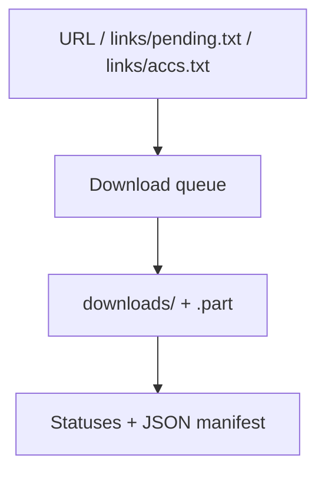
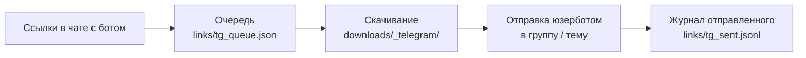

# 📥 EromeDownloader

> Консольный загрузчик публичных альбомов, медиафайлов и аккаунтов Erome.

🌐 **Язык / Language:** [Русский](README_RU.md) · [English](README.md)


## 📌 Обзор

Программа скачивает публичные альбомы, отдельные файлы и новые альбомы аккаунтов Erome. Поддерживает очереди, параллельную загрузку, докачку и отслеживание аккаунтов. Интерфейс консольный: после запуска показывается главное меню, режим выбирается номером. Отдельный режим — Telegram-бот: присылаете ему ссылки на альбомы и профили, а он скачивает их и выкладывает в вашу группу.

> [!NOTE]
> Авторизация Erome, cookies и private albums не поддерживаются.

## ✨ Возможности

- Пять режимов: одна ссылка, очередь, проверка аккаунтов, только поиск новых альбомов, Telegram-бот
- Telegram-бот: ссылки на альбомы и профили из чата → скачивание → отправка в группу или тему от вашего аккаунта; можно присылать много ссылок подряд, не дожидаясь окончания предыдущих
- Параллельная загрузка нескольких альбомов и файлов
- Докачка через `.part`-файлы и HTTP Range
- Отслеживание новых альбомов аккаунтов (`links/accs.txt`)
- Статус-файлы очереди и JSON manifest
- Опциональная сортировка альбомов по размеру и фильтры `skip_videos` / `skip_images`
- Импорт ссылок из браузерных закладок (`extract_links.py`)

## 🏗️ Как это работает



Режимы:

| Режим | Источник | Поведение |
| --- | --- | --- |
| `1` | URL из консоли | Скачивает один direct URL, альбом или все новые альбомы аккаунта |
| `2` | `links/pending.txt` | Обрабатывает очередь, повторяет failures и обновляет status-файлы |
| `3` | `links/accs.txt` | Проверяет отслеживаемые аккаунты и скачивает новые альбомы |
| `4` | `links/accs.txt` | Только находит новые альбомы и добавляет их в `pending.txt` |
| `5` | Чат с Telegram-ботом | Принимает ссылки, скачивает и отправляет в группу, см. [раздел ниже](#-telegram-бот-режим-5) |

- Режим `1` для одного альбома или файла пишет только manifest. Если ввести аккаунт, он ведёт себя как очередь: статусы его альбомов попадают в `ready.txt`, `failed.txt` и `banned.txt`, а сам аккаунт — в manifest.
- Режим `3` всегда собирает и изображения, и видео: `skip_images` и `skip_videos` к нему не применяются.
- Режим `4` считает известными URL из `ready`, `banned`, `failed` и `pending`, поэтому failed URL автоматически в очередь не возвращается.
- Ссылки на альбомы понимаются в любом виде (`http://`, без `www`, без `https://`, с `?…` на конце) и хранятся в одном: `https://www.erome.com/a/<id>`.
- Если страницы аккаунта прочитаны не все (сайт ответил ошибкой или временно закрыл доступ), аккаунт считается проваленным — частичный список не выдаётся за полный. В режимах `3` и `4` он проверится заново при следующем запуске, в режиме `2` перейдёт из `pending.txt` в `failed_accs.txt` (верните его в `pending.txt` вручную).
- Сбой на одной ссылке или в одном альбоме (например, недопустимое имя папки) не останавливает остальные: он помечается `failed` и пишется в консоль.

### Управление в консоли

- Главное меню: `1`–`5` — режимы из таблицы выше, `0` (или `q`, `exit`) — выход. Пустой ввод выбирает `1`. После каждого действия меню показывается снова.
- Режим можно выбрать сразу, без меню: `start.bat 5` (или `python main.py 5`). Программа выполнит его один раз и закроется, а не вернётся в меню, — так удобно запускать Telegram-бота из менеджера скриптов или планировщика. Код выхода: `0` — режим отработал, `1` — не смог запуститься или завершился ошибкой, `2` — неизвестный параметр.
- `Ctrl+C` прерывает текущее действие и возвращает в меню; `.part`-файлы и очереди сохраняются, незавершённое продолжится при следующем запуске.
- Во время работы внизу обновляется одна строка прогресса: сколько ссылок, альбомов и файлов обработано, объём, скорость и оставшееся время.
- Горячие клавиши (только в интерактивной консоли, работают и в русской раскладке): `S` — статус, `P` — пауза, `Q` — остановиться после текущего элемента. Пауза и остановка действуют между элементами: ссылками и альбомами очереди, аккаунтами; уже начатый альбом или файл дойдёт до конца. При скачивании одного альбома или файла (режим `1`) работает только `S`; для аккаунта в режиме `1` пауза и остановка действуют между его альбомами. Необработанное остаётся в очереди.
- Файлы `links/*.txt` можно править руками, пока открыто меню: они перечитываются перед каждым действием.

## 🚀 Быстрый старт

### Требования

- Python 3.14+
- Доступ в интернет
- Зависимости из `requirements.txt`

### Установка

Windows: [start.bat](start.bat) сам создаёт `.venv` и ставит зависимости (`pip install -r requirements.txt` выполняется при каждом запуске, подходящие версии повторно не скачиваются). Вручную:

```powershell
python -m venv .venv
.\.venv\Scripts\python.exe -m pip install -r requirements.txt
```

Linux / macOS:

```bash
python3 -m venv .venv
./.venv/bin/python -m pip install -r requirements.txt
```

### Конфигурация

Отдельной настройки не требуется: если `config.json` нет, он создаётся со значениями по умолчанию, а недостающие ключи добавляются встроенными значениями. Подробнее в следующем разделе.

### Запуск

```powershell
.\start.bat
```

```bash
./.venv/bin/python main.py
```

Папки `downloads/` и `links/` создаются автоматически.

## ⚙️ Конфигурация

`config.json` (значения по умолчанию):

```json
{
  "max_connections": 6,
  "min_connections_per_parallel_album": 3,
  "max_parallel_albums": 3,
  "auto_sort_links": true,
  "album_prefetch_connections": 6,
  "account_page_connections": 3,
  "account_max_pages": 500,
  "sort_albums_by_size": true,
  "album_size_probe_connections": 3,
  "album_size_probe_timeout": 20,
  "chunk_size_mb": 1,
  "max_attempts": 4,
  "page_attempts": 3,
  "connect_timeout": 30,
  "idle_timeout": 180,
  "skip_videos": false,
  "skip_images": false,
  "manifest_path": "links/manifest.json"
}
```

| Переменная | По умолчанию | Допустимо | Описание |
| --- | --- | --- | --- |
| `max_connections` | `6` | 1–256 | Общий целевой лимит соединений загрузки |
| `min_connections_per_parallel_album` | `3` | 1–256 | Минимум соединений на параллельный альбом |
| `max_parallel_albums` | `3` | 1–256 | Максимум одновременно обрабатываемых альбомов |
| `auto_sort_links` | `true` | true / false | Сортировать очередь перед обработкой |
| `album_prefetch_connections` | `6` | 1–256 | Лимит параллельного чтения страниц альбомов |
| `account_page_connections` | `3` | 1–256 | Лимит запросов страниц аккаунта |
| `account_max_pages` | `500` | 1–100000 | Лимит страниц одного аккаунта |
| `sort_albums_by_size` | `true` | true / false | Оценивать размер и сортировать альбомы |
| `album_size_probe_connections` | `3` | 1–256 | Параллельные проверки размера |
| `album_size_probe_timeout` | `20` | 1–86400 | Тайм-аут проверки размера, секунды |
| `chunk_size_mb` | `1` | 1–1024 | Размер записываемого chunk, МБ |
| `max_attempts` | `4` | 1–100 | Попытки скачивания файла |
| `page_attempts` | `3` | 1–100 | Попытки чтения HTML-страницы |
| `connect_timeout` | `30` | 1–86400 | Тайм-аут соединения, секунды |
| `idle_timeout` | `180` | 1–86400 | Допустимое время без новых данных, секунды |
| `skip_videos` | `false` | true / false | Не включать видео там, где режим учитывает фильтр |
| `skip_images` | `false` | true / false | Не включать изображения там, где режим учитывает фильтр |
| `manifest_path` | `links/manifest.json` | путь | Путь к JSON manifest: относительно проекта или абсолютный |

При запуске значения проверяются, о каждой правке пишется предупреждение в консоли: число вне диапазона заменяется ближайшим допустимым (`300` → `256`), а не число или не `true`/`false` — значением по умолчанию. Неизвестный ключ (например, опечатка) игнорируется, тоже с предупреждением.

### Очереди и результаты

| Путь | Назначение |
| --- | --- |
| `links/pending.txt` | Очередь direct URLs, альбомов и аккаунтов |
| `links/accs.txt` | Постоянный список отслеживаемых аккаунтов |
| `links/ready.txt` | Успешно завершённые batch-ссылки |
| `links/failed.txt` | Ссылки, не скачанные после последней попытки |
| `links/banned.txt` | Недоступные ссылки, включая HTTP 403/404/410 |
| `links/ready_accs.txt` | Успешно обработанные аккаунты |
| `links/failed_accs.txt` | Аккаунты с ошибкой |
| `links/banned_accs.txt` | Недоступные аккаунты |
| `links/manifest.json` | Записи файлов, альбомов и аккаунтов |

Один URL на строку; пустые строки и строки с `#` в начале игнорируются batch-режимами. После финальной ошибки режим `2` переносит URL из `pending.txt` в `failed.txt`; чтобы повторить, верните URL в `pending.txt` вручную.

`manifest.json` — отчёт, на основе которого решения не принимаются. Он записывается не чаще раза в 5 секунд и в конце каждого действия; если файл занят или диск недоступен, программа один раз предупреждает и продолжает скачивать.

Имена папок и файлов подгоняются под Windows: запрещённые символы и управляющие знаки заменяются на `_`, имена устройств (`CON`, `NUL`, `COM1`…) получают `_` в начале, слишком длинные имена сокращаются (расширение файла сохраняется).

### Импорт из закладок

1. Экспортируйте закладки браузера в `bookmarks*.html` и положите файл рядом с `main.py`.
2. Запустите `python extract_links.py`, выберите файл и подтвердите операцию. Ссылки приводятся к единому виду `https://www.erome.com/a/<id>`, повторы убираются.

> [!WARNING]
> Importer **заменяет содержимое** `links/pending.txt` найденными ссылками, а не объединяет их с очередью. Сохраните старый файл или объедините списки вручную.

## 🤖 Telegram-бот (режим 5)

Режим 5 принимает ссылки на альбомы и профили Erome в чате с ботом, скачивает их и выкладывает в группу (в нужную тему форума) от имени вашего аккаунта — через «юзербота» на Telethon. Ссылок можно присылать сколько угодно и в любой момент: всё встаёт в очередь и обрабатывается по порядку, ждать окончания предыдущей не нужно.



### Настройка

1. Создайте бота у [@BotFather](https://t.me/BotFather) (`/newbot`) и скопируйте токен.
2. Запустите программу и выберите пункт `5`. Если `telegram.json` ещё нет, он создаётся из `telegram.example.json`, а токен программа спросит сама. Заполните остальные поля (таблица ниже); файл можно подготовить и вручную.
3. `api_id` и `api_hash` берутся на [my.telegram.org](https://my.telegram.org) (API development tools). Вместо них можно указать `credentials_config_path` — путь к другому JSON-файлу с блоком `telegram` (`api_id`, `api_hash`).
4. При первом запуске выводится QR-код: на телефоне откройте «Настройки → Устройства → Подключить устройство» и отсканируйте его **тем аккаунтом, от имени которого пойдёт отправка**. Если задан `account_id`, а вошли другим аккаунтом, сессия закрывается и вход нужно повторить. Облачный пароль (2FA), если он есть, вводится в консоли. Сессия хранится в `data/telegram.session`, повторно входить не нужно.
5. Напишите боту `/start` и присылайте ссылки.

`telegram.json` (образец — `telegram.example.json`):

| Поле | Описание |
| --- | --- |
| `bot_token` | Токен бота от @BotFather |
| `owner_ids` | ID аккаунтов, которым разрешён бот; остальных бот игнорирует (в консоли один раз пишется их ID) |
| `account_id` | ID аккаунта-отправителя: проверяется при входе; `null` — не проверять |
| `chat_id` | ID группы, например `-1001234567890` |
| `thread_id` | ID темы форума (число в конце ссылки `t.me/c/…/<thread_id>`); `0` — писать в основной чат |
| `api_id`, `api_hash` | Данные приложения Telegram; можно оставить пустыми, если задан `credentials_config_path` |
| `credentials_config_path` | Путь к JSON с `api_id` / `api_hash` (блок `telegram`), например от другого проекта |
| `session_path` | Файл сессии без расширения, по умолчанию `data/telegram` |
| `delete_after_upload` | Удалять локальные файлы сразу после того, как Telegram их принял (по умолчанию `true`) |
| `upload_connections` | Предел числа соединений при отправке крупных файлов, 1–24 (по умолчанию `12`) |

### Как пользоваться

- Присылайте ссылки на альбомы (`erome.com/a/…`) и профили (`erome.com/имя`): по одной или сразу несколько в одном сообщении. Бот удаляет ваше сообщение и показывает состояние в одном сообщении-панели, которое обновляется само: текущий альбом (сколько скачано и отправлено, скорость, оставшееся время), очередь и недавно завершённое (время МСК).
- Присылать можно в любой момент, в том числе пока идёт загрузка: ссылка встаёт в конец очереди, а бот сразу отвечает отдельным сообщением — что добавлено и на каком месте, какие ссылки уже были в очереди или в работе, что идёт прямо сейчас (альбом, сколько отправлено, оставшееся время). Ссылки, присланные подряд, попадают в один ответ; следующий ответ заменяет прежний, а старый убирается через 10 минут.
- Кнопки панели: пауза / продолжить, отменить текущий альбом, очистить очередь (нажать дважды). Пауза не прерывает порцию файлов, которая отправляется сейчас: она дойдёт до конца, дальше ничего не начнётся.
- Команды: `/start` — инструкция, `/queue` — вернуть панель в конец чата, `/resend ссылка` — выложить альбом заново (альбом, который сейчас в очереди или отправляется, трогать нельзя: бот попросит дождаться окончания).
- Профиль разворачивается в альбомы, которых в группу ещё не отправляли, от старых к новым; уже полностью отправленные пропускаются. Читается он сразу после текущего альбома, не в конце очереди, поэтому результат (сколько альбомов добавлено или что профиль недоступен) известен быстро; его альбомы встают в очередь на место профиля. Чтобы догнать новые файлы в старом альбоме, пришлите ссылку на сам альбом.
- Если сайт не ответил (страница альбома или профиля не открылась или прочиталась не целиком), задание не пропадает: оно откладывается и пробуется заново через 1, 3 и 10 минут (всего 4 попытки), а остальные задания идут своим чередом. В панели у такого задания написано, когда будет повтор.
- В консоли работают `S` — статус, `P` — пауза, `Q` — остановиться после текущей порции файлов, `Ctrl+C` — прервать сразу. Очередь хранится на диске и продолжится при следующем запуске.
- Если бот перестал получать сообщения (токен отозван, нет сети, тот же бот запущен ещё где-то), в консоли появится сообщение; при затянувшемся сбое оно повторяется не чаще раза в час.

### Что и как отправляется

- Фото и видео уходят альбомами по 10 штук, подпись (название и ссылка на альбом) — на первом файле. Видео отправляются с превью и воспроизводятся без полной загрузки. GIF и фото, не подходящие под требования Telegram, уходят отдельными сообщениями или файлами. Видео без звука программа помечает для Telegram (`nosound_video`): иначе он принимает такой ролик за GIF и отклоняет весь альбом. Если Telegram всё же отказал, альбом уходит по одному файлу, а следующие ролики без звука идут отдельными сообщениями, остальное по-прежнему собирается в альбом.
- Пока отправляется одна порция (до 10 файлов), скачивается следующая. Файлы лежат в `downloads/_telegram/`, не в основном архиве `downloads/`.
- Журнал `links/tg_sent.jsonl` запоминает каждую принятую Telegram порцию, а каждому сообщению задан постоянный `random_id`: повторная ссылка, обрыв связи или перезапуск в любой момент не создают дублей. При повторе отправляется только недостающее.
- Не скачавшиеся файлы пробуются ещё раз в конце альбома; если часть так и не пришла, альбом помечается как частично отправленный, а повторная ссылка докачает остаток.
- Файлы, которые Telegram отверг сам по себе (не влезли в лимит, отвергнуты как негодное медиа), запоминаются в журнале: повторная ссылка и разворот профиля их заново не скачивают, а в панели у альбома написано «всё отправлено, кроме N файлов» с причиной. Временные сбои (обрыв связи, запрет группы) в журнал не попадают и при следующей попытке пробуются снова. `/resend` сбрасывает и эту отметку; если лимит аккаунта вырос (появился Premium), отметка перестаёт действовать сама.
- Лимит файла в Telegram — 2 ГБ, у аккаунта с Premium — 4 ГБ.
- Если группа или тема не принимает сообщения (тема закрыта, нет прав), очередь не теряется: программа проверяет снова всё реже — через 1, 2, 4 … до 15 минут, а в панели и консоли пишет причину.
- Режим можно запустить только в одном окне.

## 🗂️ Структура проекта

```text
EromeDownloader/
├── main.py                # точка входа, меню режимов
├── extract_links.py       # импорт ссылок из закладок
├── start.bat              # лаунчер Windows (.venv + зависимости)
├── config.json            # настройки
├── telegram.example.json  # образец настроек Telegram-режима
├── telegram.json          # ваши настройки Telegram-режима: токен и ID (в Git не входит)
├── requirements.txt       # зависимости
├── erome/
│   ├── config.py          # загрузка настроек
│   ├── console.py         # логи, строка прогресса, горячие клавиши
│   ├── downloader.py      # загрузка файлов
│   ├── models.py          # модели данных
│   ├── net.py             # сетевой слой
│   ├── storage.py         # очереди и статус-файлы
│   ├── manifest.py        # отчёт manifest.json
│   ├── ui.py              # терминальный UI: цвета, строка статуса, ввод
│   ├── urls.py            # разбор и сортировка URL
│   ├── workflow.py        # сценарии режимов 1-4
│   ├── tg_settings.py     # режим 5: telegram.json, токен, учётные данные
│   ├── tg_state.py        # режим 5: очередь и журнал отправленного
│   ├── tg_media.py        # режим 5: тип файла, метаданные видео, превью
│   ├── tg_transport.py    # режим 5: соединение Telethon, загрузка файлов, вход по QR
│   ├── tg_userbot.py      # режим 5: юзербот — альбомы и сообщения, что считается доставленным
│   ├── tg_pipeline.py     # режим 5: скачивание → отправка
│   ├── tg_bot.py          # режим 5: бот (aiogram), панель, команды, кнопки
│   └── tg_mode.py         # режим 5: запуск — замок, логи, консоль, все задачи вместе
├── downloads/             # скачанные файлы; _telegram/ — временные файлы режима 5 (в Git не входит)
├── links/                 # очереди, manifest, tg_queue.json и tg_sent.jsonl (в Git не входит)
└── data/                  # сессия Telegram и лог режима 5 (в Git не входит)
```

## 🔒 Безопасность и приватность

- Для режимов 1–4 пароли, cookies и API keys не требуются.
- Direct URL не ограничен доменом Erome; используйте только доверенные ссылки.
- `downloads/`, `links/`, `data/`, `telegram.json`, `.venv/`, `.env`, файлы сессий и логи исключены из Git.
- Токен бота и файл сессии `data/telegram.session` дают полный доступ к боту и аккаунту: не публикуйте их. Если токен попал в чужие руки, перевыпустите его у @BotFather (`/revoke`).
- Manifest может содержать исходные URL и локальные имена файлов — учитывайте это перед публикацией.

## ⚠️ Ограничения

- Парсинг зависит от текущей HTML-разметки Erome: `og:title`, `<source>` и `img.img-back`.
- Докачка работает только если сервер поддерживает `Range`; иначе файл загружается заново.
- Размер может остаться неизвестным, если сервер не сообщает его через `HEAD` или range response.
- Повреждённый manifest переносится в файл с суффиксом `.bad`; если его не удаётся ни прочитать, ни перенести, в этом запуске он не перезаписывается.
- Режим 5 ограничен лимитами Telegram (скорость отправки, частота сообщений в группу): при ограничении программа сама ждёт и продолжает.

## 📄 Лицензия

© 2026 Timofey Soroka. Программа распространяется на условиях [GNU General Public License v3.0](LICENSE): её можно свободно использовать, изменять и распространять, при этом изменённые версии, которые вы распространяете, остаются под той же лицензией и с открытым исходным кодом. Гарантий нет. Исходный код: <https://github.com/soroka01/EromeDownloader>.

## 💬 Поддержка

Можно [форкнуть репозиторий](https://github.com/soroka01/EromeDownloader/fork) и доработать под себя. Если проект пригодился, поставьте [Star](https://github.com/soroka01/EromeDownloader) — так я увижу, что он был кому-то полезен.

---

with love ❤️
